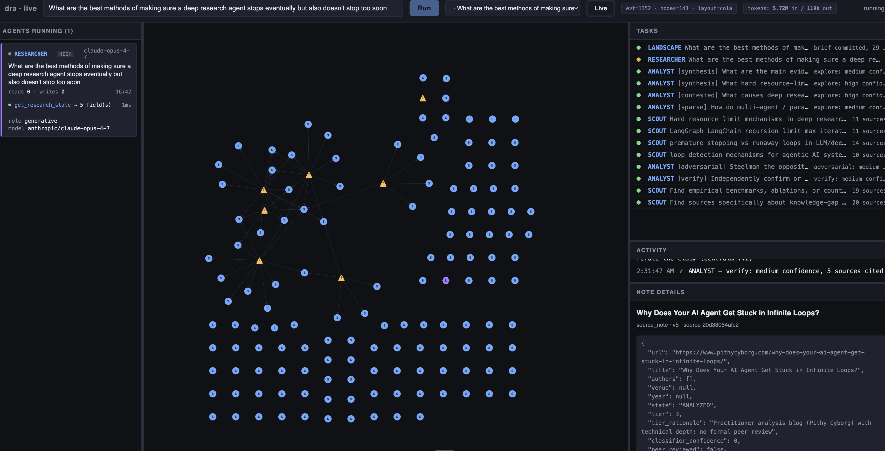
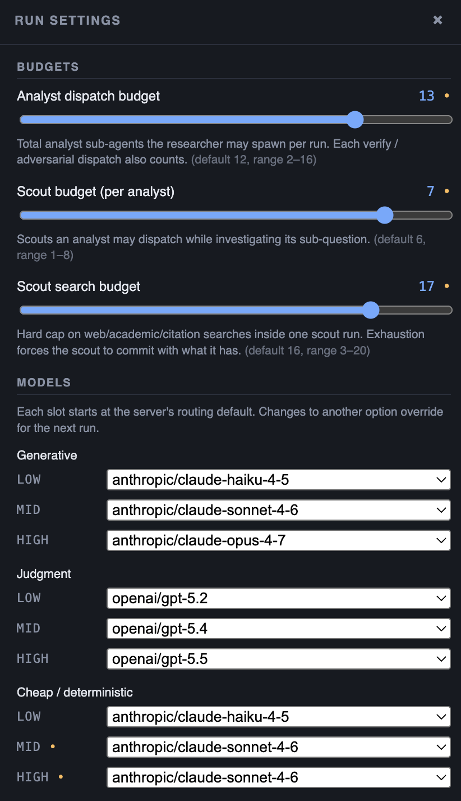
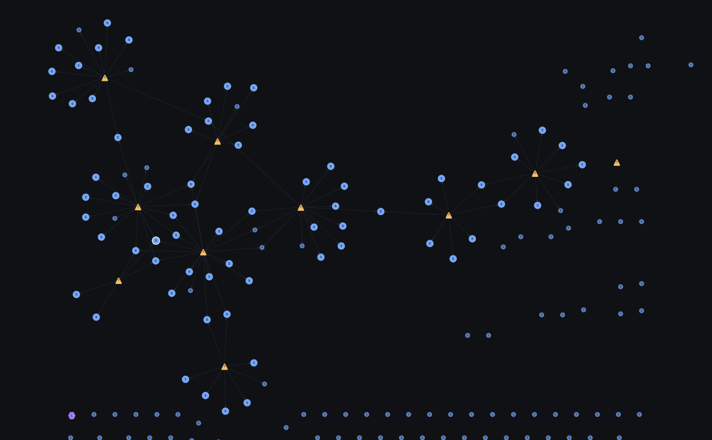
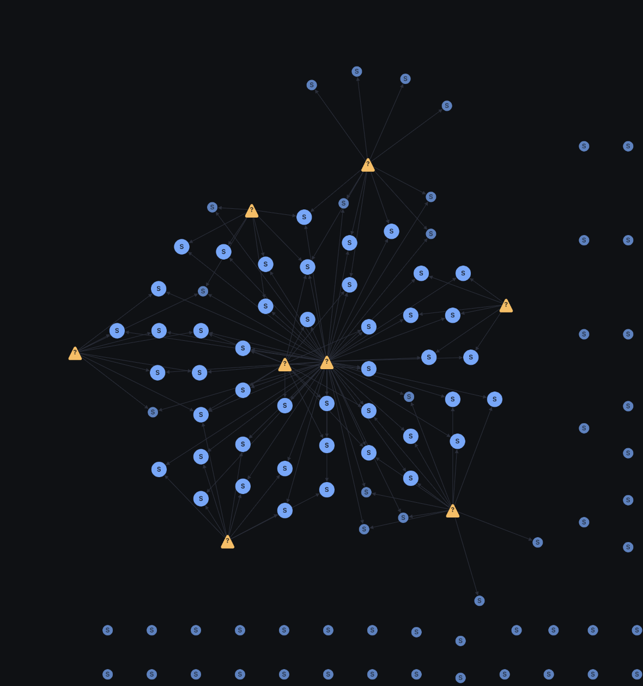
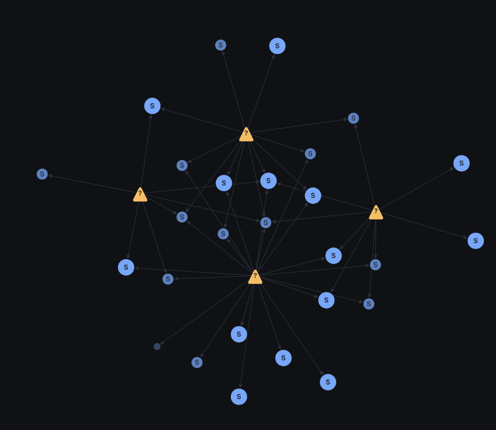

# deep-research-agent

An agentic deep-research system. A top-level **researcher** agent is handed a
natural-language query, runs a **landscape** scouting pass to map the terrain,
then iteratively dispatches **analyst** sub-agents (which in turn dispatch
**scouts**) against focused sub-questions. Every finding traces back to a
verbatim quote on a typed source note.

The whole system is built on [pydantic-ai](https://ai.pydantic.dev/). Agents talk to each other only through a shared, async-safe **note graph**.



## What this gets you

- **Evidence-grounded output.** Every material claim in the final report
  traces to a source note; every claim on a source note carries a verbatim
  quote. No unsupported assertions.
- **Cross-family verification.** The researcher can dispatch `verify` or
  `adversarial` analysts on load-bearing claims. Those run on a *different*
  model family than the original `explore` analyst (routing is structural,
  not prompt discipline).
- **Live observability.** `dra serve` runs the same pipeline under a FastAPI
  app with a WebSocket-streamed UI: agents-running panel, note graph,
  per-agent tool-call ticker, token usage, final report.
- **Replayable artifacts.** Each run dumps `report.md`, `report.json`,
  `notes.json`, `token_usage.json`, and `run.log` into `runs/<run_id>/`.

## Setup

```bash
uv sync
cp config/local.toml.example config/local.toml   # fill in api_base_url, api_key, retrieval keys
```

All LLM traffic goes through one OpenAI-compatible endpoint (a LiteLLM
router, typically). Which model answers each `(role, tier)` pair is decided
by a **routing config** — see `config/routing_diverse.yaml` for the default
policy (Claude for generative, GPT for judgment, Haiku for cheap
deterministic). The live UI exposes per-run overrides for budgets and the
model assigned to each `(role, tier)` slot:

<p align="center">
  
</p>

## Usage

Headless — prints run status, writes artifacts under `runs/<run_id>/`:

```bash
uv run dra research "your query here"
uv run dra research "..." --routing config/routing_diverse.yaml
```

Live UI — FastAPI + WebSocket on `http://127.0.0.1:8000`:

```bash
uv run dra serve
uv run dra serve --host 0.0.0.0 --port 8080
```

## Note graph

The note graph is the system's central state — every agent reads from
and writes to it. Triangles are sub-questions, circles (`s`) are source
notes, edges record which sources each analyst pulled into which
sub-question. A few examples from real runs:

<p align="center">
  
  
  
</p>

## Where to go next

- **[docs/architecture.md](docs/architecture.md)** — how the agent actually
  works. Agent hierarchy, the note graph, dispatch modes, budgets, model
  routing, event flow.
- **[docs/codebase-map.md](docs/codebase-map.md)** — what lives where in
  `src/deep_research_agent/` at module granularity.

## Repo layout

```
src/deep_research_agent/   # all code
config/                    # routing policies (yaml) + local.toml (gitignored)
runs/                      # per-run artifacts
docs/                      # architecture, codebase map, experiments, example reports
```
